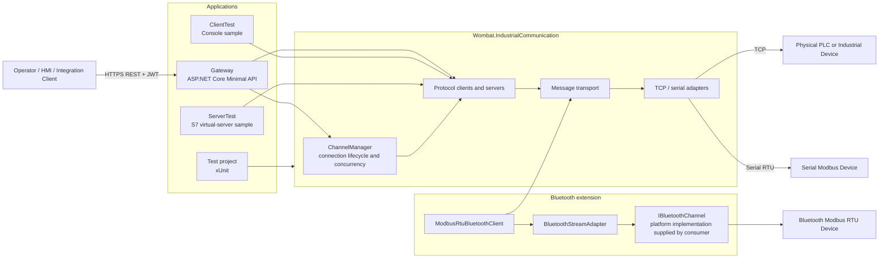
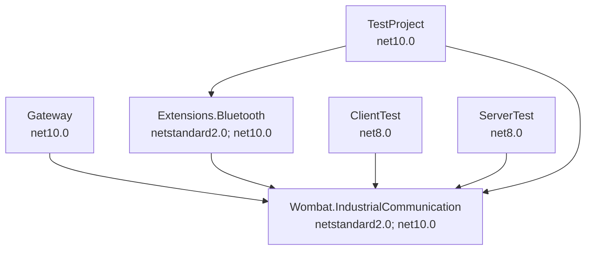
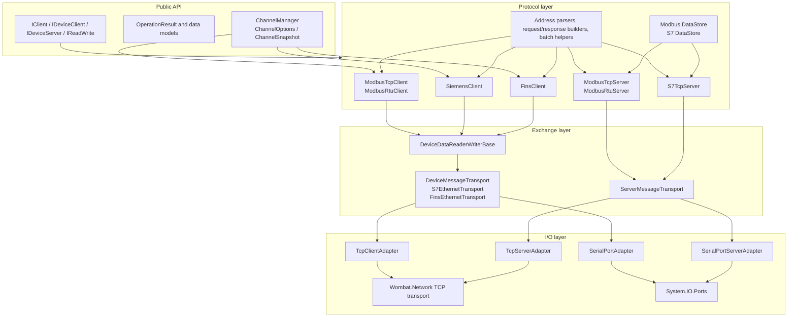
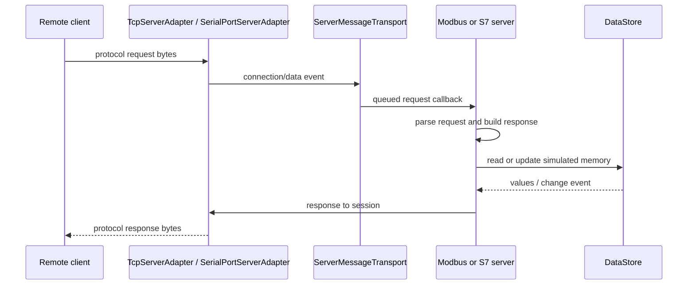
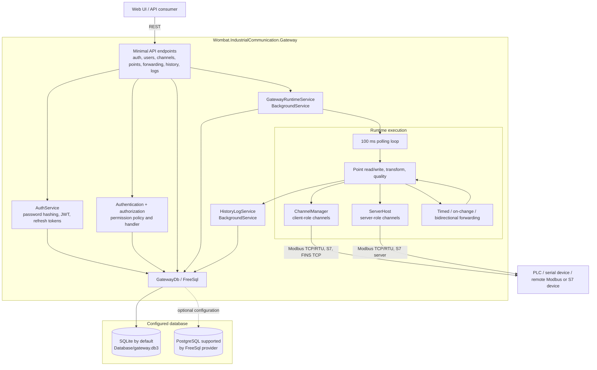
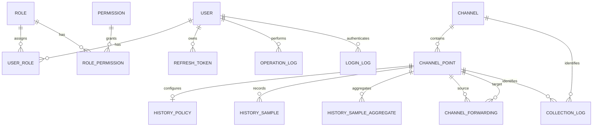

# Wombat.IndustrialCommunication System Architecture

This document describes the implemented system as of the current source tree. Mermaid diagrams render in GitHub, GitLab, and current VS Code Markdown preview extensions.

## 1. System Overview



## 2. Project Dependencies



## 3. Core Library Layers



### Client request path

```mermaid
sequenceDiagram
    participant Caller
    participant CM as ChannelManager / Client
    participant P as Protocol implementation
    participant MT as DeviceMessageTransport
    participant A as TCP or Serial adapter
    participant D as Device

    Caller->>CM: ReadAsync or WriteAsync
    CM->>CM: wait for operation slot; connect/reconnect if needed
    CM->>P: typed operation and address
    P->>P: parse address; build protocol request
    P->>MT: unicast read/write message
    MT->>A: send frame
    A->>D: TCP or serial bytes
    D-->>A: response bytes
    A-->>MT: received bytes
    MT->>MT: validate frame and protocol error
    MT-->>P: OperationResult and response
    P-->>Caller: converted typed value / write result
```

`ChannelRuntime` owns the connection state machine: `Created -> Connecting -> Online`, with `Faulted -> Reconnecting` on a transport failure. It applies connection, operation, and exponential-retry limits from `ChannelOptions`.

### Server request path



Implemented core server types are `ModbusTcpServer`, `ModbusRtuServer`, and `S7TcpServer`; `ServerHost` serializes each server's start/stop lifecycle.

## 4. Gateway Architecture



### Gateway data model



Gateway startup first initializes bootstrap data, then starts the history and runtime hosted services. The runtime loads enabled channel records, creates either a client channel or server host according to `Channel.Role`, and then polls enabled points at their configured `ScanIntervalMs` (minimum 100 ms).

## 5. Protocol and Transport Coverage

| Capability | Client | Server | Carrier |
| --- | --- | --- | --- |
| Modbus TCP | `ModbusTcpClient` | `ModbusTcpServer` | TCP |
| Modbus RTU | `ModbusRtuClient` | `ModbusRtuServer` | Serial |
| Siemens S7 | `SiemensClient` | `S7TcpServer` | TCP |
| Omron FINS | `FinsClient` | Not implemented | TCP |
| Modbus RTU over Bluetooth | `ModbusRtuBluetoothClient` | `ModbusRtuBluetoothServer` | Consumer-provided `IBluetoothChannel` |

The library also contains shared address models for Allen-Bradley and Mitsubishi, but this source tree does not contain corresponding protocol client/server implementations. They are intentionally not shown as supported runtime paths.

## 6. Source Map

| Responsibility | Main source location |
| --- | --- |
| Core channel lifecycle | `Wombat.IndustrialCommunication/Channels` |
| Client/server transports and adapters | `Messaging`, `Adapters`, `Server` |
| Modbus implementation | `Wombat.IndustrialCommunication/Modbus` |
| Siemens S7 implementation | `Wombat.IndustrialCommunication/PLC/S7` |
| Omron FINS implementation | `Wombat.IndustrialCommunication/PLC/FINS` |
| Bluetooth extension | `Wombat.IndustrialCommunication.Extensions.Bluetooth` |
| Gateway web/API/runtime/persistence | `Wombat.IndustrialCommunication.Gateway` |
| Executable samples | `ClientTest`, `ServerTest` |
| Automated tests | `Wombat.IndustrialCommunicationTestProject` |
