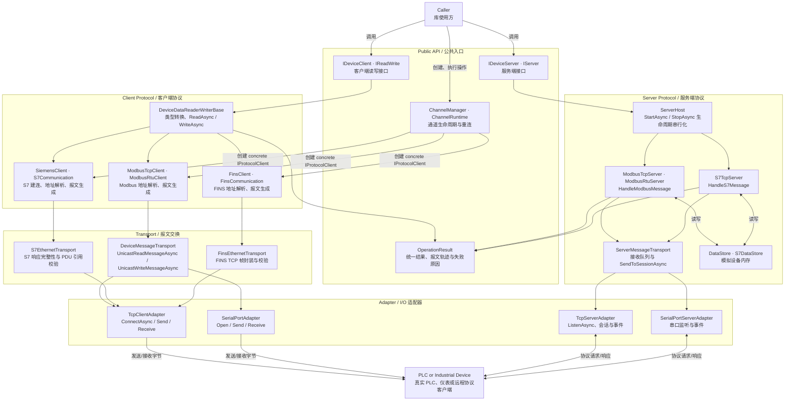
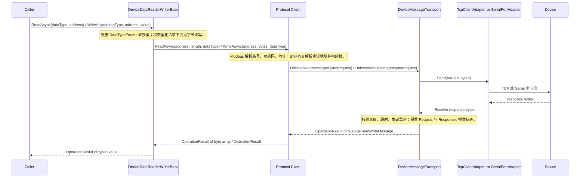
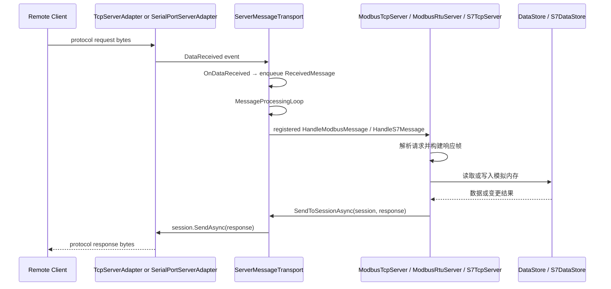
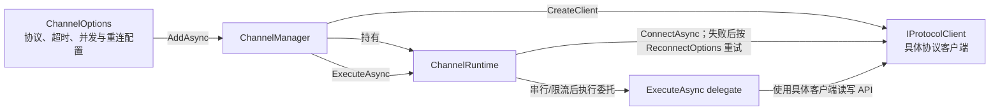

# Wombat.IndustrialCommunication 系统流程图

>  `Wombat.IndustrialCommunication` 通讯库系统流程图。

## 1. 模块调用总图

## 2. 客户端读写调用链

`S7EthernetTransport` 与 `FinsEthernetTransport` 继承 `DeviceMessageTransport` 的交换职责：前者额外完成 S7 报文长度和 PDU 引用校验，后者处理 FINS TCP 帧。`ModbusTcpClient` 与 `ModbusRtuClient` 使用 `DeviceMessageTransport` 的 TCP/RTU 分支。

## 3. 服务端请求调用链

`ModbusTcpServerBase` 和 `S7TcpServerBase` 在构造时通过 `RegisterMessageHandler` 注册各自的处理器；服务端不是通过 `DeviceMessageTransport` 主动轮询设备，而是由适配器事件驱动并读写内存数据存储。

## 4. ChannelManager 调用关系

`ChannelManager` 只负责连接状态、并发槽位、超时与重连；它不解析工业协议。`CreateClient` 当前映射到 `ModbusTcpClient`、`ModbusRtuClient`、`SiemensClient` 与 `FinsClient`。

## 5. 模块调用分析

| 模块 | 对外英文接口 | 下游调用 | 职责边界 |
| --- | --- | --- | --- |
| `Abstractions` | `IClient`, `IDeviceClient`, `IDeviceServer`, `IStreamResource` | 由实现类依赖 | 只定义契约，不承载协议逻辑。 |
| `Core` | `DeviceDataReaderWriterBase.ReadAsync`, `WriteAsync` | 协议客户端的受保护读写实现 | 统一类型转换和 `OperationResult` 返回。 |
| `Channels` | `AddAsync`, `ExecuteAsync`, `RestartAsync`, `RemoveAsync` | `IProtocolClient.ConnectAsync` 与使用方委托 | 连接编排，不处理单帧协议。 |
| `Modbus` | `ModbusTcpClient`, `ModbusRtuClient` | `ModbusAddressParser` → 报文对象 → `DeviceMessageTransport` | Modbus TCP/RTU 的读写、批量分块和响应解析。 |
| `PLC/S7` | `SiemensClient`, `S7Communication` | `S7EthernetTransport` → `TcpClientAdapter` | S7 初始化握手、读写报文和响应关联。 |
| `PLC/FINS` | `FinsClient`, `FinsCommunication` | `FinsEthernetTransport` → `TcpClientAdapter` | FINS TCP 读写报文的编码与校验。 |
| `Messaging` | `UnicastReadMessageAsync`, `UnicastWriteMessageAsync` | `IStreamResource.Send` / `Receive` | 将单次请求与响应配对，形成可追踪结果。 |
| `Adapters` | `ConnectAsync`, `Send`, `Receive`, `ListenAsync` | TCP 网络或系统串口 | 只处理字节流和会话事件，不理解 Modbus/S7/FINS。 |
| `Server` | `ServerHost`, `ServerMessageTransport` | 适配器事件 → 协议 Server → DataStore | 管理监听生命周期、消息排队、响应回写。 |
| `Modbus/Data`, `PLC/S7` | `DataStore`, `S7DataStore` | 被对应 Server 调用 | 保存模拟 PLC 状态；不参与客户端真实设备通信。 |

## 6. 已实现协议路径

| 协议 | Client path | Server path | 载体 |
| --- | --- | --- | --- |
| Modbus TCP | `ModbusTcpClient` → `DeviceMessageTransport` → `TcpClientAdapter` | `ModbusTcpServer` → `ServerMessageTransport` → `TcpServerAdapter` | TCP |
| Modbus RTU | `ModbusRtuClient` → `DeviceMessageTransport` → `SerialPortAdapter` | `ModbusRtuServer` → `ServerMessageTransport` → `SerialPortServerAdapter` | Serial |
| Siemens S7 | `SiemensClient` → `S7EthernetTransport` → `TcpClientAdapter` | `S7TcpServer` → `ServerMessageTransport` → `TcpServerAdapter` | TCP |
| Omron FINS | `FinsClient` → `FinsEthernetTransport` → `TcpClientAdapter` | 未实现 | TCP |
